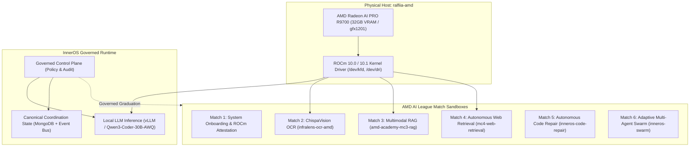

# InnerOS on AMD: Governed Agentic Intelligence

> **Canonical Judge-Facing Umbrella Repository for AMD AI League 2026**  
> *One-Sentence Thesis:* InnerOS on AMD is a governed, local-first agentic platform providing durable cognitive automation, multimodal perception, and verifiable AI workflows accelerated on AMD ROCm and Radeon AI PRO hardware.

[](https://lablab.ai/event/amd-ai-league-2026)
[](https://rocm.docs.amd.com/)
[](https://www.amd.com/)
[](LICENSE)

---

## Executive Overview

This umbrella repository serves as the central evaluation gateway for judges and evaluators of the **AMD AI League 2026**. Rather than moving or duplicating code from challenge-specific repositories, this hub links the independently verified Match deliverables, establishes architectural cohesion, catalogs verified container images, and documents how each capability graduates into the production InnerOS agentic platform.



---

## Match 1–6 Status Matrix

| Match | Challenge Domain | Status | Challenge Repository | Verified Docker Deliverable / Proof |
| :--- | :--- | :---: | :--- | :--- |
| **Match 1** | Onboarding & Hardware Baseline | **COMPLETED / VERIFIED** | [MATCH_01_ONBOARDING.md](matches/MATCH_01_ONBOARDING.md) | ROCm 10.1 / gfx1201 Hardware Attestation PASS |
| **Match 2** | Vision OCR (ChispaVision) | **COMPLETED / VERIFIED** | [infralens-ocr-amd](https://github.com/Rafa-Innerchispa/infralens-ocr-amd) | `us-central1-docker.pkg.dev/innerops-agentic-platform/amd-academy-public/chispavision-mc2:final-512` |
| **Match 3** | Multimodal RAG | **COMPLETED / VERIFIED** *(Ready for Points)* | [amd-academy-mc3-rag](https://github.com/Rafa-Innerchispa/amd-academy-mc3-rag) | `us-central1-docker.pkg.dev/innerops-agentic-platform/amd-academy-public/amd-academy-mc3-rag:mc3-final` |
| **Match 4** | Web Retrieval & Search | **ACTIVE DEVELOPMENT** | [amd-academy-mc4-web-retrieval](https://github.com/Rafa-Innerchispa/amd-academy-mc4-web-retrieval) | Live agent web retrieval pipeline |
| **Match 5** | Autonomous Code Repair | **UPCOMING** | [MATCH_05_CODE_REPAIR.md](matches/MATCH_05_CODE_REPAIR.md) | Self-healing AST / PyTest repair harness |
| **Match 6** | Adaptive AI & Orchestration | **UPCOMING** | [MATCH_06_ADAPTIVE_AI.md](matches/MATCH_06_ADAPTIVE_AI.md) | Cross-node autonomous agentic swarm |

---

## Verified Docker Artifacts (Ready for Evaluation)

Judges can pull and evaluate pre-built, tested container images hosted on Google Artifact Registry:

### 1. Match 2 — ChispaVision OCR
- **Image Reference:** `us-central1-docker.pkg.dev/innerops-agentic-platform/amd-academy-public/chispavision-mc2:final-512`
- **Digest:** `sha256:dbfcaf89fc2d47823406c1ceeefef464a98a7e4328226511ab1625c3d721868f`
- **Evaluation Command:**
  ```bash
  docker pull us-central1-docker.pkg.dev/innerops-agentic-platform/amd-academy-public/chispavision-mc2:final-512
  docker run --rm -p 8080:8080 us-central1-docker.pkg.dev/innerops-agentic-platform/amd-academy-public/chispavision-mc2:final-512
  ```

### 2. Match 3 — Multimodal RAG
- **Image Reference:** `us-central1-docker.pkg.dev/innerops-agentic-platform/amd-academy-public/amd-academy-mc3-rag:mc3-final`
- **Digest:** `sha256:652a0ff48600c93116a6afb9859ce05d2ce8c8acb85d0b96835f3657e32ea910`
- **Evaluation Command:**
  ```bash
  docker pull us-central1-docker.pkg.dev/innerops-agentic-platform/amd-academy-public/amd-academy-mc3-rag:mc3-final
  docker run --rm -p 8501:8501 us-central1-docker.pkg.dev/innerops-agentic-platform/amd-academy-public/amd-academy-mc3-rag:mc3-final
  ```

See [artifacts/DOCKER_IMAGES.md](artifacts/DOCKER_IMAGES.md) for full image inspection and execution recipes.

---

## Local Hardware Acceleration (AMD Radeon AI PRO R9700)

All workloads in this repository and its satellite challenges are developed and evaluated on physical AMD hardware:
- **GPU:** AMD Radeon AI PRO R9700 (Device ID `0x7551`)
- **Architecture:** RDNA4 (`gfx1201`), 64 Compute Units, 32 GB VRAM
- **Driver Stack:** AMD ROCm 10.0 / 10.1 native driver (`/dev/kfd`, `/dev/dri`)
- **PyTorch Environment:** `rocm/pytorch:rocm10.0_ubuntu26.04_py3.14_pytorch_release_2.13.0`
- **Inference Server:** vLLM v0.32 upstream + WNA16 / AWQ Triton acceleration kernels

For exhaustive benchmarks, hardware attestation telemetry, and driver configuration, see [docs/AMD_STACK.md](docs/AMD_STACK.md).

---

## Truth Boundary & Governance Statement

> **Evaluation Truth Boundary:**  
> InnerOS maintains strict operational isolation between hackathon challenge sandboxes and the production agentic platform. Each Match repository is developed, tested, and containerized in an independent git workspace and repository. While every challenge validates an essential cognitive capability (e.g. OCR, RAG, Web Search, Code Repair), capabilities graduate into the core InnerOS control plane only after passing automated security gates, non-regression certification, and canary soak tests. This repository reflects verified challenge deliverables without risking production state.

---

## Repository Documentation Map

- [docs/ARCHITECTURE.md](docs/ARCHITECTURE.md) — Comprehensive technical architecture and control plane boundaries.
- [docs/AMD_STACK.md](docs/AMD_STACK.md) — Hardware profile, ROCm 10+ driver matrix, kernel tuning, and benchmark telemetry.
- [docs/INNEROS_INTEGRATION.md](docs/INNEROS_INTEGRATION.md) — Protocol for graduating challenge deliverables into production agent swarms.
- [artifacts/DOCKER_IMAGES.md](artifacts/DOCKER_IMAGES.md) — Manifest of verified container images, sha256 digests, and run instructions.
- [artifacts/EVIDENCE.md](artifacts/EVIDENCE.md) — Verified benchmark logs, test outputs, and grading proofs.
