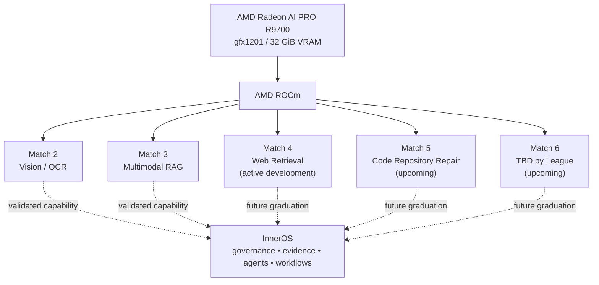

# InnerOS on AMD: Governed Agentic Intelligence

> **Canonical judge-facing umbrella repository for AMD AI League 2026**  
> **Thesis:** InnerOS uses the AMD AI League as a sequence of independent acceptance tests for local-first AI capabilities that can later graduate into a governed agentic platform.

[](https://www.amd.com/)
[](https://rocm.docs.amd.com/)
[](LICENSE)

---

## What this repository is

This is the public entry point for our AMD AI League work.

Each Match remains in its own repository and preserves its own grader contract, Docker image, tests, and evidence. This repository does **not** pretend that every challenge is already merged into production InnerOS. Instead, it documents the common architecture, the independently verified deliverables, and the path by which successful capabilities can be promoted into InnerOS.



---

## AMD AI League status

| Match | Capability | Current status | Canonical repository / evidence |
| --- | --- | --- | --- |
| **Match 1** | AMD Developer Program / Academy onboarding | **Learning in progress** | [Match 1 notes](matches/MATCH_01_ONBOARDING.md) |
| **Match 2** | Vision + OCR / ChispaVision | **VERIFIED** | [infralens-ocr-amd](https://github.com/Rafa-Innerchispa/infralens-ocr-amd) |
| **Match 3** | Grounded Multimodal RAG | **VERIFIED · ready for LabLab points submission** | [amd-academy-mc3-rag](https://github.com/Rafa-Innerchispa/amd-academy-mc3-rag) |
| **Match 4** | Intelligent Web Information Retrieval | **ACTIVE DEVELOPMENT** | Challenge workspace exists; not part of the current verified submission |
| **Match 5** | Code Repository Repair | **UPCOMING** | [Match 5 placeholder](matches/MATCH_05_CODE_REPAIR.md) |
| **Match 6** | Final League challenge | **UPCOMING** | [Match 6 placeholder](matches/MATCH_06_ADAPTIVE_AI.md) |

---

## Verified public Docker artifacts

These are the executable artifacts for the completed technical Matches. Both were published to Google Artifact Registry and verified for anonymous pull.

### Match 2 · ChispaVision OCR

**Image**

```text
us-central1-docker.pkg.dev/innerops-agentic-platform/amd-academy-public/chispavision-mc2:final-512
```

**Digest**

```text
sha256:dbfcaf89fc2d47823406c1ceeefef464a98a7e4328226511ab1625c3d721868f
```

**Verified evidence**
- AMD Radeon AI PRO R9700 / gfx1201 physical execution
- anonymous public pull PASS
- public artifact physically re-run on the R9700
- grader JSON contract PASS

Use the exact grader contract documented in the [Match 2 repository](https://github.com/Rafa-Innerchispa/infralens-ocr-amd). The optional visual demo is presentation-only and is not required by the grader.

### Match 3 · Grounded Multimodal RAG

**Image**

```text
us-central1-docker.pkg.dev/innerops-agentic-platform/amd-academy-public/amd-academy-mc3-rag:mc3-final
```

**Digest**

```text
sha256:652a0ff48600c93116a6afb9859ce05d2ce8c8acb85d0b96835f3657e32ea910
```

**Verified evidence**
- AMD Radeon AI PRO R9700 / gfx1201
- PyTorch `2.13.0+rocm10.0.0`
- official public sample: **10/10**
- visual questions: **2/2**
- startup + indexing: **50.49 s**
- max query latency: **23.80 s**
- peak VRAM: **31.74 GiB**
- `--network none`: PASS
- anonymous public pull: PASS

Use the exact index/query grader contract documented in the [Match 3 repository](https://github.com/Rafa-Innerchispa/amd-academy-mc3-rag).

---

## AMD hardware and runtime boundary

The completed Match 2 and Match 3 artifacts were validated on a physical **AMD Radeon AI PRO R9700** (`gfx1201`, 32 GiB VRAM) using their mandated **ROCm 10.0** challenge environments.

Separately, the broader InnerOS / HyperLoom runtime is actively validating a newer **ROCm 10.1 + vLLM** serving stack on the same R9700. That runtime work is deliberately kept separate from the already-validated Match 2 and Match 3 submission artifacts, so challenge reproducibility is not changed after verification.

---

## Why InnerOS

The individual Match repositories are deliberately narrow because the League grades reproducible capabilities, not our entire operating platform.

InnerOS is the layer above them: governance, evidence, model/tool routing, persistent coordination, human approval, and real-world workflows. A Match capability is only described as part of InnerOS after it has passed its own technical gates. That distinction matters: this repository is a map of verified work and planned integration, not a claim that every future Match is already production-ready.

---

## Documentation

- [Architecture](docs/ARCHITECTURE.md)
- [AMD stack](docs/AMD_STACK.md)
- [InnerOS integration model](docs/INNEROS_INTEGRATION.md)
- [Docker artifacts](artifacts/DOCKER_IMAGES.md)
- [Evidence](artifacts/EVIDENCE.md)
- [Match 2](matches/MATCH_02_VISION_OCR.md)
- [Match 3](matches/MATCH_03_MULTIMODAL_RAG.md)
- [Match 4](matches/MATCH_04_WEB_RETRIEVAL.md)

---

## Current submission boundary

For the LabLab submission currently being prepared, the verified executable artifacts are **Match 2 and Match 3**. Match 4 is active development; Match 5 and Match 6 are future League work.

This boundary is intentional: verified claims are kept separate from roadmap claims.
